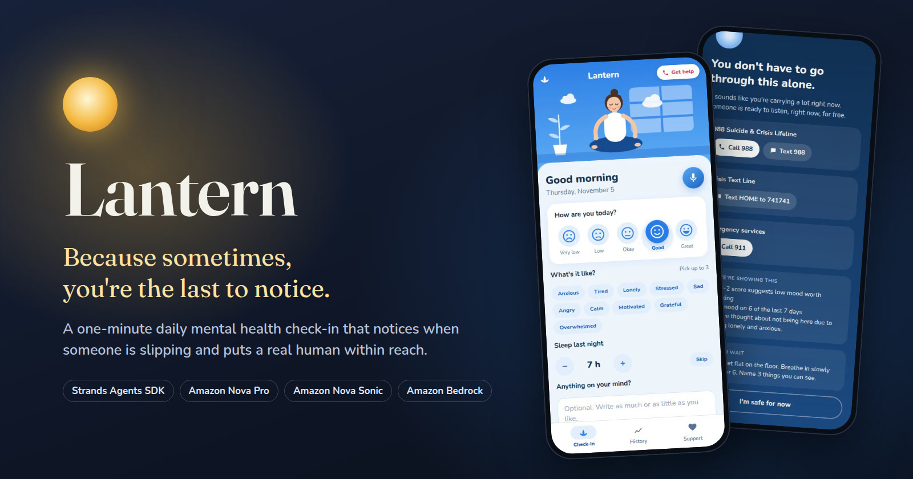

# Lantern



**Because sometimes, you're the last to notice.**

**Lantern helps anyone look after their mental health: it notices when they're slipping, before they do, and puts a real human within reach the moment it senses risk.** It's a one-minute daily check-in run by agents built with the [Strands Agents SDK](https://strandsagents.com) on Amazon Bedrock, with every safety decision made in code the AI can't override.

- **Demo video (2:34):** [https://youtu.be/RL9mvNXc4Vw]

> Lantern is a prototype, not a clinical tool or a substitute for professional care. If you or someone you know is struggling, call or text **988** in the US.

## Why it exists

Mental health usually gets attention too late. The slide starts quietly: a few bad nights, skipped plans, a sentence that sounds like a joke. Help exists, from 988 in the US to Tele-MANAS 14416 in India, but people rarely reach for it at the moment it matters most, and few tools help them stay well day to day.

Good mental health is like fitness: easier to maintain than to rebuild. One honest minute a day shows a person what lifts them, what wears them down, and when something has shifted. On most days that means a kind reflection and one small exercise. On the rare day it means more, Lantern is ready.

## Who it's for

Lantern is for everyone, not only people in crisis, and it asks very little of them:

- **Anyone, any day.** One minute, typed or spoken, with no appointment and no diagnosis.
- **Compared with yourself.** Mood, sleep and activity are read against each person's own usual, so what counts as a change fits their life.
- **People expected to look fine.** Athletes facing selection and injury, and professionals mistaking burnout for a busy quarter, get a private place to stop performing.
- **People with no one watching.** A bullied teen who tells no one, or an older adult living alone, gets a companion that notices when the routine changes.

## What it does

1. **A one-minute check-in.** Mood, up to three feelings, sleep (filled in from Apple Health) and an optional note. On low days it adds two short screening questions (PHQ-2).
2. **A short, kind reply.** A Strands agent on Amazon Nova Pro writes two or three warm sentences and suggests one small exercise from a reviewed list. It never diagnoses, prescribes or lectures.
3. **Noticing the pattern.** Rules watch the 7-day mood trend, and the agent reads what's said between the lines, the indirect wording no keyword list catches.
4. **A real human, one tap away.** On a high-risk day, a calm screen offers one-tap call or text to 988, the Crisis Text Line and 911 (or local lines for India, the UK or Australia), with the person's own emergency contact first, and explains in plain words why it opened.
5. **Just talk.** Some days typing is too much. A voice companion on Amazon Nova Sonic listens and replies out loud, and every line the person says gets the same safety checks, live.
6. **Remembers, and shows you what it remembers.** A profile (preferred name, age group, gender, what helps, people they trust, an emergency contact) and short facts the agents save, such as an exam on Saturday. Every memory is visible and deletable, or forget everything at once.
7. **Cycle-aware, never dismissive.** Period tracking is offered to anyone except a male profile, and is on by default for Female. History shades the week before each predicted period so patterns are easy to spot. The AI sees only the phase, never dates, and never puts feelings down to hormones.
8. **Notices the body too.** Sleep, steps, exercise and heart data from Apple Health (simulated in this prototype), each against the person's own usual. A big drop in sleep or steps appears as "Lantern noticed", even before they check in. Changes they expect, like a new baby, shift work, illness or travel, aren't treated as warning signs.

## Safety lives in code

Most AI wellness apps trust the model. Lantern doesn't: the model adds understanding, and plain code makes every safety decision.

- **The AI can raise risk, never lower it.** Rules (phrases, PHQ-2 and item 9, the 7-day trend, body signals) and the agent each produce findings, and the final level is the highest one (`app/service.py`).
- **Help before the AI finishes.** A rules-only precheck can open the crisis screen in milliseconds, before the agent replies.
- **Unsafe words stay out of replies.** A Strands steering handler asks for one rewrite if a draft diagnoses, mentions medication, sends the person to treatment, offers a quick fix, dismisses feelings as hormones or draws medical conclusions from heart data. An output-guard hook replaces anything that still slips through. Neither can lower risk.
- **Body signals inform, never decide.** They raise risk to elevated at most, never open the crisis screen alone, and missing days (a watch not worn) are never read as inactivity. Heart data is context only.
- **Memory without anchoring.** Past calm days never lower today's rating, and crisis details and phone numbers are never saved as memories.
- **Some things never reach a model:** crisis numbers (built into the page), the emergency contact's phone number and period dates.
- **Fails safe.** If the AI fails, the check-in is already saved, the rules still decide, and support lines are still shown.

## How it's built

| Part | Strands feature | File |
|---|---|---|
| Check-in agent | `Agent` on Nova Pro with `structured_output_model` | `app/agent/agent.py` |
| User-bound tools | `@tool`: `get_mood_history`, `list_coping_exercises`, `get_body_signals`, and `remember` when memory is on | `app/agent/tools.py`, `app/memory.py` |
| Reply steering | `SteeringHandler`: `steer_after_model` returns `Guide` for one rewrite | `app/agent/steering.py` |
| Output guard | `HookProvider` on `AfterInvocationEvent` | `app/agent/guard.py` |
| Voice companion | `BidiAgent` on Nova Sonic | `app/voice/agent.py` |
| Per-line risk check | `Agent` on Nova Pro with structured output | `app/agent/agent.py` |
| Memory | `FileSessionManager` + `SlidingWindowConversationManager`, shared by both agents | `app/memory.py` |
| Body signals | Deterministic rules on (simulated) Apple Health summaries | `app/health.py` |

See [How Lantern works](docs/how-it-works.md) for diagrams and a walkthrough, and [Architecture.md](Architecture.md) for the full design reference.

## Evidence so far

The prototype catches risky notes reliably, answers in seconds, and costs well under a cent per check-in. These are early numbers from live runs against Amazon Bedrock in November 2026: small samples, not a clinical validation. They test safety, speed and cost; whether a daily habit helps people stay well is what a pilot would show.

| Measure | Result |
|---|---|
| Risk detection (`pytest -m live`) | 17 of 17 labelled notes reached their required level in the first run, with none of the 5 safe notes over-escalated. Two later runs scored 16 of 17, each time because Bedrock's content filter blocked one reply mid-sentence; repeating those notes gave 12 of 12 |
| Time to the crisis screen | The rules take about 0.035 ms, so an explicit risk statement opens help before the AI has finished |
| Reply time | median 5.1 s, slowest 8.3 s across 16 check-ins (before memory) |
| Unsafe replies stopped | Steering and the output guard kept every diagnosis, medication and phone number away from the person in the adversarial replies we reviewed |
| Cost | about $0.004 per check-in on Nova Pro, roughly $1.50 per person per year for a daily check-in (before memory) |
| Engineering | 147 automated tests, all passing |

At under a cent a day, a school, a clinic, an employer, a sports club or a community programme could offer Lantern to everyone, not only to those who can pay.

## Run it

You need Python 3.12 and AWS credentials with Amazon Bedrock access to:

- **Amazon Nova Pro** through the APAC inference profile `apac.amazon.nova-pro-v1:0`, called from `ap-southeast-2`
- **Amazon Nova Sonic** (`amazon.nova-2-5-sonic`) in `ap-northeast-1`, for the voice companion

```bash
python -m venv .venv && source .venv/bin/activate
pip install -r requirements.txt
python -m app.web --region US                  # open http://localhost:8000
python -m app.web --region US --profile dave   # start as a demo person
```

No Bedrock access? `python -m app.web --no-agent` runs the rules, standard replies and the crisis screen without Nova Pro.

| Flag | Default | What it does |
|---|---|---|
| `--region` | `IN` | Crisis lines to show: `US`, `IN`, `GB`, `AU` |
| `--profile` | none | Start as a demo person: `dave`, `maya`, `jordan`, `priya` or `robert` (replaces `--demo` history) |
| `--demo` | `decline` | Seeded history only: `decline`, `good`, `steady` or `empty` |
| `--host`, `--port` | `127.0.0.1`, `8000` | Use `--host 0.0.0.0` to open it from a phone on the same Wi-Fi |
| `--no-agent` | off | Skip Nova Pro; the voice companion still uses Nova Sonic |

Environment variables (all optional):

| Variable | Default |
|---|---|
| `CHECKIN_MODEL_ID` | `apac.amazon.nova-pro-v1:0` |
| `CHECKIN_AWS_REGION` | `ap-southeast-2` |
| `CHECKIN_MODEL_TIMEOUT_S` | `30` |
| `CHECKIN_VOICE_MODEL_ID` | `amazon.nova-2-5-sonic` |
| `CHECKIN_VOICE_REGION` | `ap-northeast-1` |
| `CHECKIN_VOICE_ID` | `tiffany` |
| `CHECKIN_HOTLINE_REGION` | `IN` |
| `CHECKIN_DATA_DIR` | `.lantern` (profiles and session files; personal data, git-ignored) |
| `CHECKIN_MEMORY_WINDOW` | `48` messages kept by the check-in agent |
| `CHECKIN_VOICE_MEMORY_WINDOW` | `20` messages kept by the voice agent |

There is also a terminal version: `python -m app.cli --demo decline`.

### Where things are in the app

- **Check-in:** the daily check-in, and the mic button for the voice companion. "Lantern noticed" appears here when Health data shows a change.
- **History:** the mood chart (pre-period weeks shaded, if tracked), an overview, and the Apple Health card.
- **Support:** **About you** (the profile), **What Lantern remembers**, crisis lines and coping exercises.
- **Get help** (top right on every screen): the crisis screen.

### Demo people

Five fictional people, each a real pattern, shaped the prototype. We started with those least likely to ask for help or to have someone checking in, because a daily habit that works for them can work for anyone.

| Person | Age group | Story | Apple Health (simulated) |
|---|---|---|---|
| Dave, 15 | 13–17 | Bullied at school; tells no one | Sleep and steps fall as the bullying starts |
| Maya, 24 | 18–25 | Studying for her nursing licensing exam; tracks her cycle, period due in a few days | Slightly less sleep; nothing flagged |
| Jordan, 21 | 18–25 | College student in a new city; a good week | Steady and active; nothing flagged |
| Priya, 34 | 26–59 | New mother on little sleep | Short sleep, marked as expected with a new baby |
| Robert, 67 | 60+ | Recently widowed; hasn't checked in yet | His dog walks have stopped: noticed before his first check-in |

Each comes with a profile, memories and a matching mood history. All names are fictional, and emergency numbers use the 555-01xx range reserved for fiction.

## Tests

```bash
pytest              # 147 offline tests, no AWS needed
pytest -m live      # live eval against Bedrock
```

## Project layout

```
app/
  agent/            Strands check-in agent, tools, prompts, steering, output guard
  voice/            Nova Sonic BidiAgent and the live voice session
  risk/             deterministic risk engine and phrase rules
  store/            storage interface and in-memory store
  web/              Starlette server and the mobile web UI
  data/             reviewed coping exercises and crisis hotlines
  memory.py         profile, memories and the Strands session manager
  health.py         Apple Health summaries, baselines and body rules
  cycle.py          period-cycle phase from a few dates
  demo_profiles.py  the five demo people
  service.py        one check-in: save, rules, agent, merge, reply
docs/               how it works, with diagrams
tests/              offline tests and the live eval
```


## License

[MIT](LICENSE)
